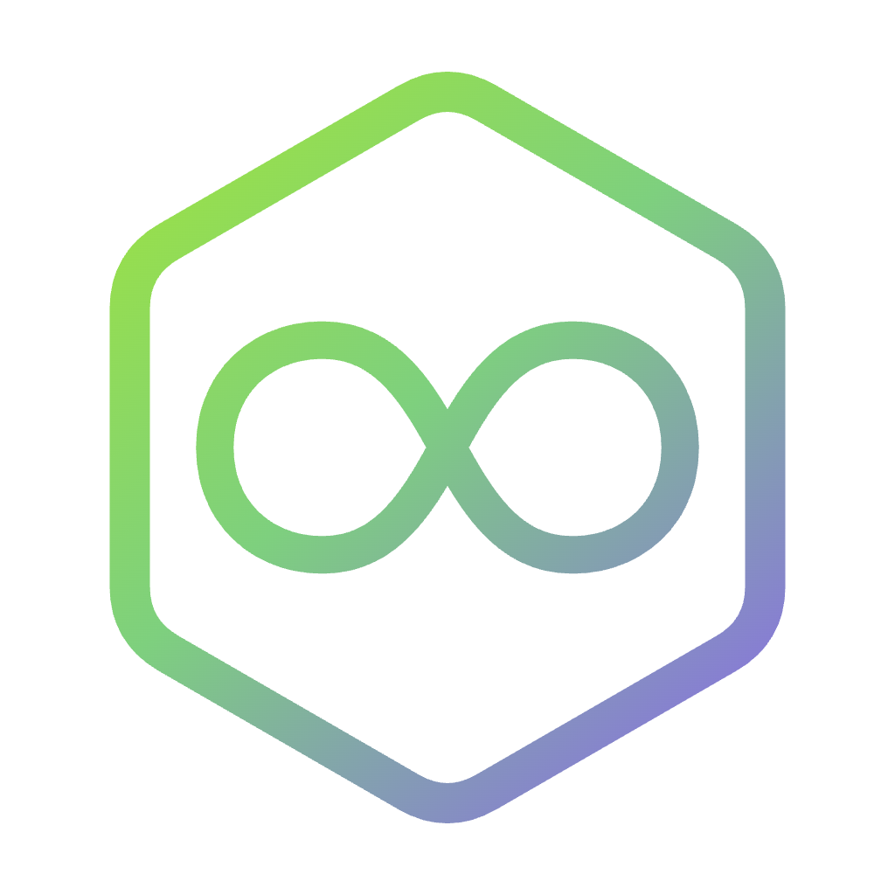

# NaN Builders for CodexBar

A [CodexBar](https://github.com/steipete/CodexBar) user plugin that shows your [NaN Builders](https://nan.builders)
subscription quotas in the macOS menu bar: one bar per usable model, the tokens used against the cap, and when each
window resets.

[](https://nan.builders/?ref=built-with-nan)

Current version: **0.0.2**, the single file `nan-usage.ts`. Changes: [CHANGELOG.md](CHANGELOG.md).

<p align="center"></p>

## What it shows

- **No aggregate bar.** The card lists every model directly, so there is no top percentage duplicating the first row.
  Each model row carries its own reset and, when you bought one, its extra-usage pool.
- **A per-model breakdown** in the popover card: tokens used against the cap, the reset date, and an explicit label for
  models you cannot use (`Requiere suscripción Plus`, `No incluido en tu plan`) instead of a fake percentage.
- **Extra usage** is shown on its own terms: `+125M extra · caduca 29 abr 2027`, because a purchased pool expires on an
  absolute date instead of on the billing cycle. A paused pool reads `pausado, requiere membresía activa`, and one you
  are already drawing on reads `en uso`.
- **The account row** tells you which credential answered (`API key` or `Dashboard session`) and whether the premium
  subscription is active on this account.
- **Named windows** in the snapshot, so Settings → Plugins → Menu bar metric can pin any single model to the bar,
  and widgets and quota warnings can use them.

A model the cluster no longer serves is dropped instead of lingering: with an API key the plugin cross-checks every
quota row against the authoritative model list at `api.nan.builders/v1/models`, so a retired model such as GLM 5.2
disappears even while the quota endpoint still reports it. No retirement list is hardcoded anywhere, and the check fails
open — an unreadable list, or a naming difference between the two endpoints, keeps the payload as reported rather than
blanking the card.

## Requirements

- CodexBar 0.82 or newer, on macOS 14+ or the Linux desktop build.
- A NaN Builders account with inference on it (`nan_member` or the GLM 5.3 premium membership) and either:
  - a **NaN API key** from [cloud.nan.builders](https://cloud.nan.builders) → user settings → **API Keys**, or
  - a browser session on `cloud.nan.builders`.

## Install

```bash
git clone https://github.com/ipepio/codexbar-nan-builders.git
mkdir -p ~/.config/codexbar/providers
cp codexbar-nan-builders/nan-usage.ts ~/.config/codexbar/providers/
```

Or download the released file directly, without cloning:

```bash
mkdir -p ~/.config/codexbar/providers
curl -fsSL https://raw.githubusercontent.com/ipepio/codexbar-nan-builders/v0.0.2/nan-usage.ts \
  -o ~/.config/codexbar/providers/nan-usage.ts
```

Then open **Settings → Plugins**, approve `nan-usage` when CodexBar lists it, and set the API key (see below).
CodexBar reads that directory on every start; no build step, no dependencies, no Node at runtime.

You can also use **Settings → Plugins → Install…** and pick `nan-usage.ts` instead of copying it by hand.

## Authentication

The plugin tries credentials in this order, and stops at the first one that returns a quota.

1. **API key** — put your key in the plugin's `API_KEY` setting (Settings → Plugins, the gear on the plugin row, or
   the same field in the approval sheet). The plugin sends `Authorization: Bearer <key>` to
   `https://cloud-api.nan.builders` and **never reads a browser cookie**. This is the recommended path: keys do not
   expire with a browser session.
2. **Dashboard cookies** — with no key configured, the plugin imports the `nan.builders` session from a supported
   browser (the same access gate the built-in Helmcode provider uses). Grant cookie access when CodexBar asks.

If both fail, the error names both options. A rejected key says so explicitly instead of silently falling back, so a
revoked key cannot hide behind a stale cookie.

## Settings

| Setting   | Type     | Required | Description                                                       |
| --------- | -------- | -------- | ----------------------------------------------------------------- |
| `API_KEY` | `secure` | No       | NaN API key. Stored by CodexBar, never logged or shown in the UI. |

No other settings. The menu-bar metric picker (Auto, primary, secondary, tertiary or a named model) is the existing
per-plugin CodexBar control, not a plugin setting.

## API contract

The plugin performs at most two `GET`s per refresh against `https://cloud-api.nan.builders`, sending either the bearer
token or the dashboard `Cookie`, plus the `Origin` and `Referer` of `https://cloud.nan.builders`:

| Endpoint            | Required | Purpose                                                                    |
| ------------------- | -------- | -------------------------------------------------------------------------- |
| `/api/usage/quota`  | Yes      | `periodStart` and `models[]` with `model`, `cap`, `tokensUsed`, `windowHours`, `periodEnd`, plus `extraTokens`, `extraUsable` and `extraExpiresAt` for a purchased extra-usage pool. |
| `/api/billing`      | No       | `subscription.premium`, which decides whether a rolling premium tier is a quota you hold. Best effort, 2 s deadline; its failure can only hide a tier, never invent one. |

With an API key the plugin also asks the inference host for the served model list, which is what removes retired models:

| Endpoint                              | Required | Purpose                                                          |
| ------------------------------------- | -------- | ---------------------------------------------------------------- |
| `api.nan.builders/v1/models`          | No       | `data[].id` of the models the cluster serves today. API key only, 4 s deadline, best effort; a cookie session never asks, and any failure keeps the quota payload whole. |

Quota has an 8 s deadline and a `Retry-After` honoured up to 10 s. A shape the plugin cannot read fails loudly as
`NaN Builders quota response format changed`, which is deliberate: this contract is unversioned.

## Troubleshooting

| Symptom | Cause |
| ------- | ----- |
| `Invalid provider plugin manifest: 'settings' must be an array` | An older copy of the file. The host requires the `settings` key to exist, even empty. |
| Only one bar under "Principal" | A CodexBar build that renders named extra windows only for Antigravity. The breakdown is in the card's detail rows instead. |
| `NaN Builders rejected the API key` | Revoked or mistyped key. Generate a new one in the platform; the plugin does not fall back to cookies on purpose. |
| `Add a NaN API key…` | No key and no `nan.builders` browser session. Either one is enough. |
| `Requiere suscripción Plus` | The account lacks the premium subscription, so that tier's window is not a measured quota. |
| A retired model still listed | No API key configured, so `/v1/models` could not be consulted. Add the key to get the cross-check. |
| No percentage in the menu bar | By design: with no aggregate bar, Auto has no window to read. Pin a model in Settings → Plugins → Menu bar metric. |

## Development

```bash
node --experimental-strip-types tests/snapshot.test.mjs
```

Seventeen checks run against a fake `ctx`: manifest shape, the icon's self-contained SVG, bearer auth, cookie fallback,
the missing-credential message, the absence of a top bar, window ordering, detail rows, reset and extra-usage lines
(available, paused and in use), premium labelling, the paid-tier window, rejection handling, and the served-model filter
with its three fail-open paths. No network and no CodexBar needed.

## Versioning

Each tag is a release of `nan-usage.ts`. Copying the file over an older one is the upgrade path; there is nothing to
build and no state to migrate. Re-approve the plugin in CodexBar whenever the manifest changed, which the approval sheet
says explicitly when it happens.

## Notes

Personal, community project; not affiliated with or endorsed by nan.builders. "NaN" and its logo belong to their
owners; the icon shipped here derives from the isotipo in `assets/`. Licensed MIT for the code.
