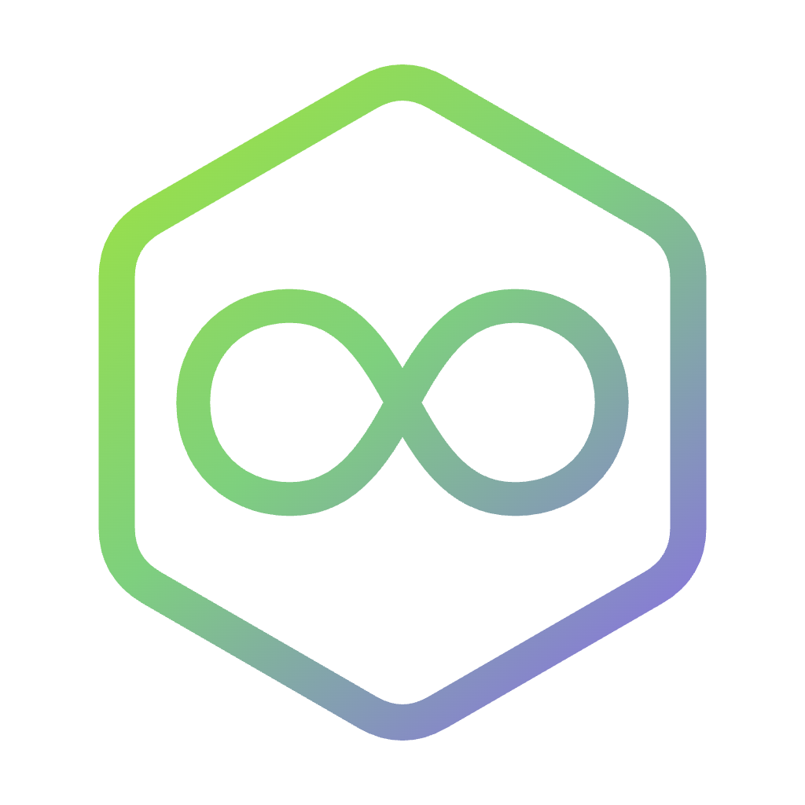

# NaN Builders for CodexBar

A [CodexBar](https://github.com/steipete/CodexBar) user plugin that shows your [NaN Builders](https://nan.builders)
subscription quotas in the macOS menu bar: one bar per usable model, the tokens used against the cap, and when each
window resets.

[](https://nan.builders/?ref=built-with-nan)

Current version: **0.0.3**, the single file `nan-usage.ts`. Changes: [CHANGELOG.md](CHANGELOG.md).

<p align="center"></p>

## What it shows

- **Dual-mode architecture (Credits & Legacy)**: Supports NaN Builders' modern credit-based billing as well as legacy per-model token quotas.
- **Credit billing system**:
  - **Aggregate primary bar**: Displays the total monthly credit allowance and consumption percentage directly in your menu bar.
  - **Pack credits**: Displays purchased credit packs as a separate row with expiration dates (`+ Pack créditos`).
  - **Model breakdown**: Details per-model consumption in credits and tokens, along with approximate rates (`≈ X cr / 1M`).
  - **Account status**: Reflects active plan, paused credits (`frozen`), or frontier model restrictions (`frontierPaused`).
- **Legacy quota fallback**:
  - If credits are not enabled or when querying via API key where credits endpoint is restricted, it seamlessly falls back to per-model token quotas.
  - **A per-model breakdown** in the popover card: tokens used against the cap, the reset date, and explicit labels for models not included.
  - **Extra usage** gets its own line and bar under each model.
- **The account row** tells you which credential answered (`API key` or `Dashboard session`) and your active plan tier.
- **Named windows** in the snapshot, so Settings → Plugins → Menu bar metric can pin any single model or the overall credits bar.

A model the cluster no longer serves is dropped instead of lingering: with an API key the plugin cross-checks every
quota row against the authoritative model list at `api.nan.builders/v1/models`, so a retired model such as GLM 5.2
disappears even while the quota endpoint still reports it. No retirement list is hardcoded anywhere, and the check fails
open — an unreadable list, or a naming difference between the two endpoints, keeps the payload as reported rather than
blanking the card.

## Requirements

- CodexBar 0.82 or newer, on macOS 14+ or the Linux desktop build.
- A NaN Builders account with active membership or credits.
- A browser session on [cloud.nan.builders](https://cloud.nan.builders) in a supported browser (Chrome, Brave, Arc, Edge, or Safari with Full Disk Access).

## Install

```bash
git clone https://github.com/ipepio/codexbar-nan-builders.git
mkdir -p ~/.config/codexbar/providers
cp codexbar-nan-builders/nan-usage.ts ~/.config/codexbar/providers/
```

Or download the released file directly, without cloning:

```bash
mkdir -p ~/.config/codexbar/providers
curl -fsSL https://raw.githubusercontent.com/ipepio/codexbar-nan-builders/v0.0.3/nan-usage.ts \
  -o ~/.config/codexbar/providers/nan-usage.ts
```

Then open **Settings → Plugins**, and approve `nan-usage` when CodexBar lists it.
CodexBar reads that directory on every start; no build step, no dependencies, no Node at runtime.

## Authentication

The plugin authenticates via **dashboard session cookies** from `nan.builders`.

- **Chromium-based browsers (Chrome, Brave, Arc, Edge)**: CodexBar reads session cookies directly once you are logged in to `cloud.nan.builders`.
- **Safari**: In macOS, Safari stores cookies in a protected container. For CodexBar to read Safari session cookies, grant **Full Disk Access** to CodexBar in **System Settings → Privacy & Security → Full Disk Access**.

## Settings

No settings required (`settings: []`). The plugin automatically detects your active session.

The plugin declares the `persistent-storage` capability to remember each extra-usage pool's size, keyed by model and expiry date.

## API contract

The plugin calls `https://cloud-api.nan.builders`, sending the dashboard `Cookie`, plus the `Origin` and `Referer` of `https://cloud.nan.builders`:

| Endpoint              | Required | Purpose                                                                    |
| --------------------- | -------- | -------------------------------------------------------------------------- |
| `/api/usage/credits`  | No       | Credit billing: `allowanceCredits`, `usedCredits`, `remainingCredits`, `packCredits`, `packExpiresAt`, and per-model consumption. Tried first. |
| `/api/usage/quota`    | Fallback | Legacy quota: `periodStart` and `models[]` with `model`, `cap`, `tokensUsed`, `windowHours`, `periodEnd`, plus extra-usage pool fields. |
| `/api/billing`        | No       | `subscription.premium`, which decides whether a rolling premium tier is a quota you hold. Best effort, 2 s deadline; its failure can only hide a tier, never invent one. |

Quota has an 8 s deadline and a `Retry-After` honoured up to 10 s.

## Troubleshooting

| Symptom | Cause |
| ------- | ----- |
| `Invalid provider plugin manifest: 'settings' must be an array` | An older copy of the file. The host requires the `settings` key to exist, even empty. |
| Only one bar under "Principal" | A CodexBar build that renders named extra windows only for Antigravity. The breakdown is in the card's detail rows instead. |
| `Sign in to cloud.nan.builders…` | No active session found. Sign in to `cloud.nan.builders` in Chrome, Brave, Arc, or grant Full Disk Access to CodexBar for Safari. |
| `Requiere suscripción Plus` | The account lacks the premium subscription, so that tier's window is not a measured quota. |
| No percentage in the menu bar | In legacy quota mode: with no aggregate bar, pin a model in Settings → Plugins → Menu bar metric. In Credits mode, an aggregate percentage is published automatically under "Créditos". |

## Development

```bash
node --experimental-strip-types tests/snapshot.test.mjs
```

Twenty-one checks run against a fake `ctx`: manifest shape, the icon's self-contained SVG, cookie session authentication,
missing-credential guidance, credit primary bar, pack credits, credit model consumption, pack-only accounts, frozen account
status, credits-to-legacy fallback, legacy quota ordering and extra-usage pools, premium labelling, and rejection handling.
No network and no CodexBar needed.

## Versioning

Each tag is a release of `nan-usage.ts`. Copying the file over an older one is the upgrade path; there is nothing to
build and no state to migrate. Re-approve the plugin in CodexBar whenever the manifest changed, which the approval sheet
says explicitly when it happens.

## Notes

Personal, community project; not affiliated with or endorsed by nan.builders. "NaN" and its logo belong to their
owners; the icon shipped here derives from the isotipo in `assets/`. Licensed MIT for the code.
